# pv-lens 用户视角可视化体验报告

> 依据材料：`requirements.md`。
> 测试对象：前端 `http://localhost:5173/`，后端 `127.0.0.1:8787` 及其调用的本机 ProVerif。
> 核查基线：分支 `dev`，commit `46079f0`，2026-11-02。

---

## 1 测试条件

| 项目 | 内容 |
|---|---|
| 浏览器 | 无头 Chromium 131，由 conda base 环境中的 Python Playwright 驱动 |
| 视口 | 主测试为 1440×813；布局测试另取 1920×1080、1280×720、1024×768 |
| 字体 | 系统已安装微软雅黑与宋体，中文渲染与 Windows 环境接近 |
| 样本 | 4 个内置样例；3 个导入样本，分别为删除 `set ignoreTypes = false.` 的 NS var3 变体、含语法错误的模型、含 `table` 与 `phase` 的模型 |
| 证据 | 截图位于 `gui-test-screenshots/`；浏览器原生悬停提示无法截图，相关结论依据页面 DOM 文本 |
| 约束 | 测试过程未修改项目代码；测试脚本为临时文件，未入库 |

---

## 2 结论

核心功能均可完成，包括装载样例、渲染画布、人工配对、对应性矩阵、运行验证、取消与超时、导入 `.pv` 文件和语法诊断。问题集中于可视化表达，可分为三类。

1. 导致错误推断的画法。不同角色的同名绑定同色；配对消息的接收端均位于发送端上方；两条无关消息在信道两侧连成一条直线；保密性判定的字面含义与实际含义相反；对应性矩阵把非安全目标事件对的 ✗ 表述为攻击路径。这些问题与 `requirements.md` 第 5 节所述的三项表征正确性原则相悖。
2. 遮挡。连线穿过词项文字、事件旗标覆盖值方块、序号被相邻元素压住，在全部样例中均出现。
3. 交互冲突。点击画布上任一对象均使页面滚回顶部源码面板，人工配对因此中断，事件旗标与矩阵之间的联动结果也不可见。

---

## 3 导致错误推断的画法

本节问题的严重程度最高。

### 3.1 不同角色的同名绑定同色

值身份颜色按 8 色循环分配。握手修正版中，clientA 与 serverB 的 pkA 同为浅蓝色，两个角色中的 x 同为橙色，画面因此暗示跨角色的同名绑定为同一值，与 U4.2 相悖。不同名的绑定同样出现同色，例如 skA 与 pkX、pkB 与 k。

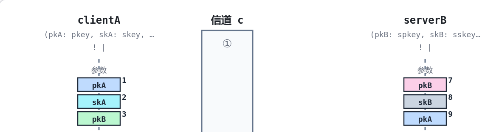

图 1　握手修正版参数簇，clientA 与 serverB 的 pkA 颜色相同

### 3.2 配对消息的接收端均位于发送端上方

两个两方样例共有 6 条配对消息，每条消息的接收端均高于发送端，高差约 63–237 px。握手修正版中，M3 在 clientA 的接收箭头比 serverB 的发送位置高约 207 px，按自上而下的阅读顺序构成先接收、后发送。消息编号顺序与画面顺序亦不一致，M3 位于 M2 上方。ADR-0008 允许同一消息的两端位于不同高度，但未规定接收端可以高于发送端。

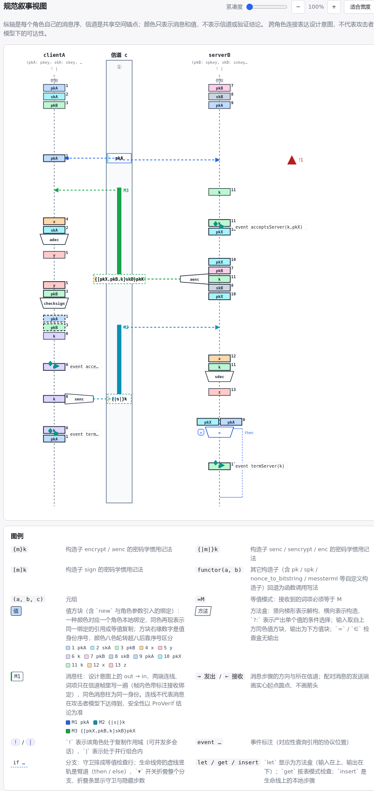

图 2　握手修正版全图，M3 与 M2 的接收箭头均高于对应的发送端

### 3.3 两条无关消息在信道两侧连成直线

NS 原版中，processA 的未配对接收步骤 `in(c,pkX)` 与 M1 到达 processB 的接收段高差约 4 px，两段在信道两侧首尾相接，易被理解为 processA 经 M1 向 processB 发送 pkX。

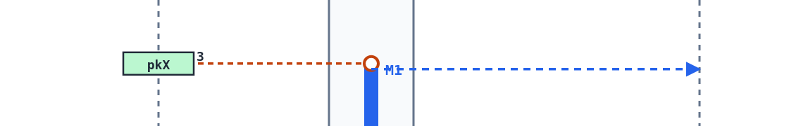

图 3　NS 原版，processA 的未配对接收线与 M1 接收段近乎共线

### 3.4 保密性判定的字面含义与实际含义相反

结果卡片将判定徽标与用户书写的查询原文并列。`attacker(secretANa)` 标注为"成立"，字面含义为攻击者获得秘密成立，实际含义为保密性成立；`attacker(secretBNa)` 标注为"被证伪"，实际含义为该秘密已泄露。说明文字仅写"该查询不成立"，没有给出以保密性表述的结论。

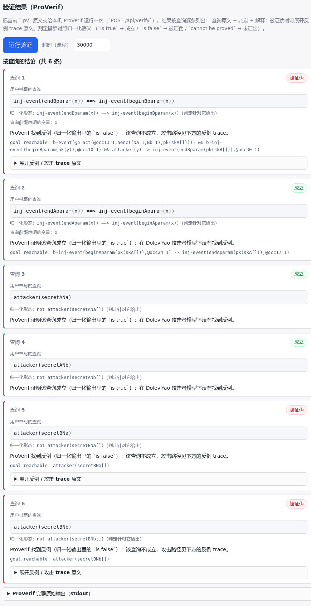

图 4　NS 原版验证结果，判定徽标与 `attacker(...)` 原文并列

### 3.5 对应性矩阵把非目标事件对的 ✗ 表述为攻击路径

首页标为"全绿"的握手修正版，矩阵 16 格中有 9 格为红色 ✗ 与"被证伪"，每格的说明均为"攻击路径见下方的反例 trace"。界面未说明自动生成的事件对多数并非协议的安全目标。

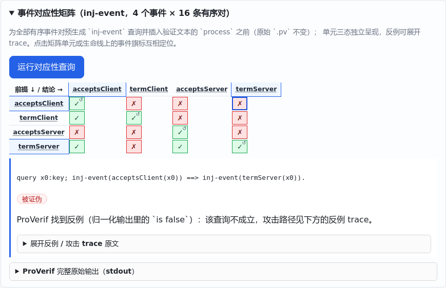

图 5　握手修正版对应性矩阵运行结果

### 3.6 选中态与未配对步骤使用同一种橙色

NS 原版中点击 processA 的参数 pkB 后，pkB、skA、pkX 三个不同绑定及其引用共 12 个元素同时显示橙褐色粗边框，与未配对消息的颜色无法区分。

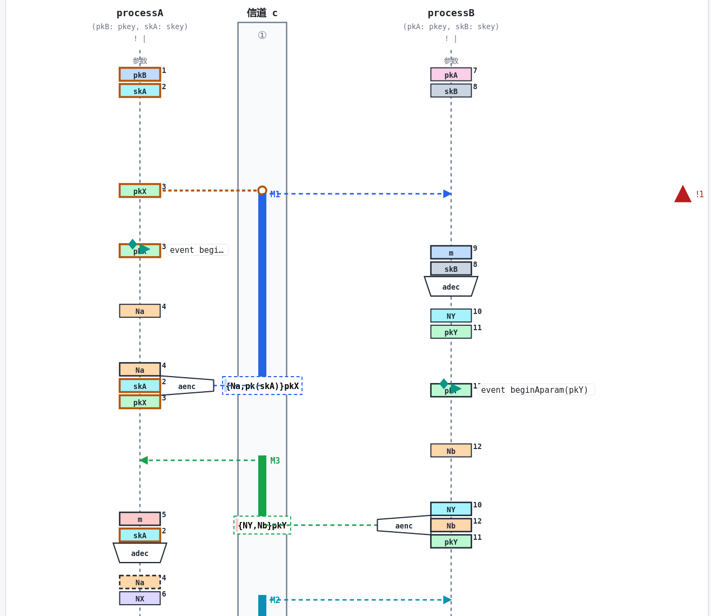

图 6　NS 原版点击 pkB 后的画布选中态

---

## 4 遮挡与重叠

| 位置 | 现象 |
|---|---|
| 信道内词项芯片 | 消息虚线穿过芯片文字，涉及 `pkA`、`{[pkX,pkB,k]skB}pkX`、`{\|s\|}k`、`{Na,pk(skA)}pkX` |
| 消息柱顶部标签 | M1、M2 标签被各自的消息线穿过 |
| 事件 | 菱形与三角旗覆盖下方值方块的文字，全部样例的全部事件均如此；事件标签框遮住序号 10、11 |
| 值方块序号 | pkX 的序号 10 被 pkA 方块压住；xA 的序号 4、xB 的序号 18 被芯片边框压住；pkxB 的序号 20 被 pk 梯形压住 |
| 生命线 | 穿过"参数"、`(=b, sb)`、`if xA = A then …` 等文字 |
| 人工配对后的消息柱 | 贯穿另外 5 个未配对端点的圆点，这些圆点易被理解为属于该消息 |
| 反例 trace | 展开后结果卡片由约 868 px 增宽至 1210 px，页面出现横向滚动，"被证伪"徽标超出视口 |

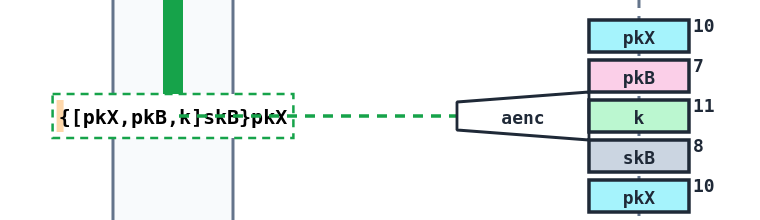

图 7　握手修正版 aenc 构造处，M3 发送段穿过词项芯片文字

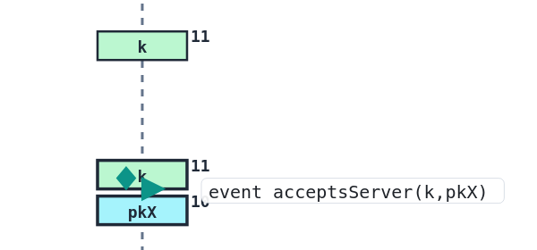

图 8　握手修正版 serverB 事件处，旗标覆盖值方块 k，标签框遮住序号 10

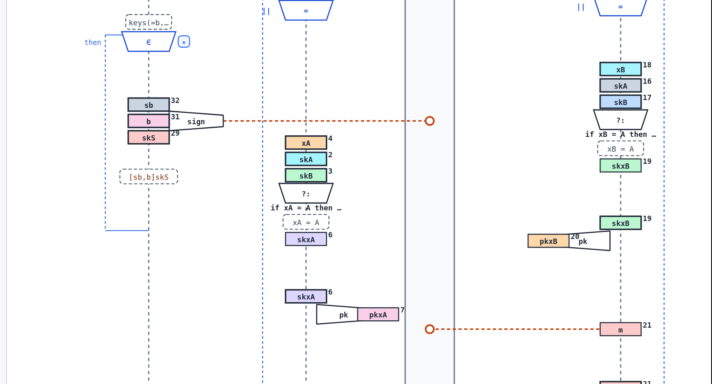

图 9　NS 修正版局部，`if xA = A then …` 被生命线穿过，序号 20 被 pk 梯形压住

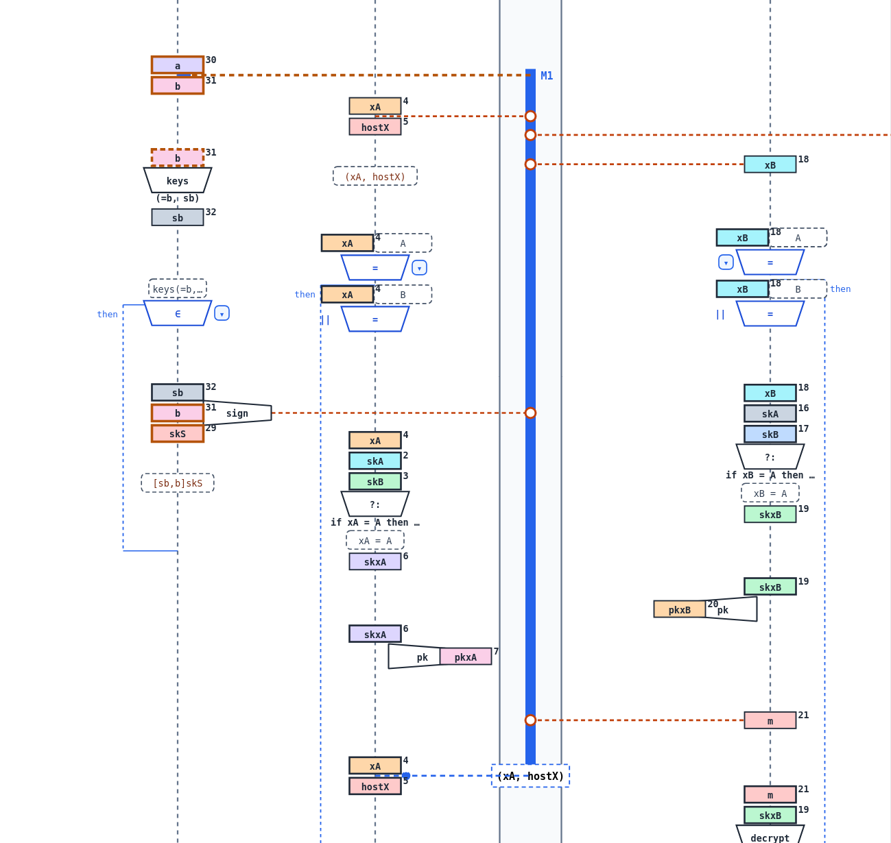

图 10　NS 修正版人工配对后，M1 消息柱贯穿其他未配对端点

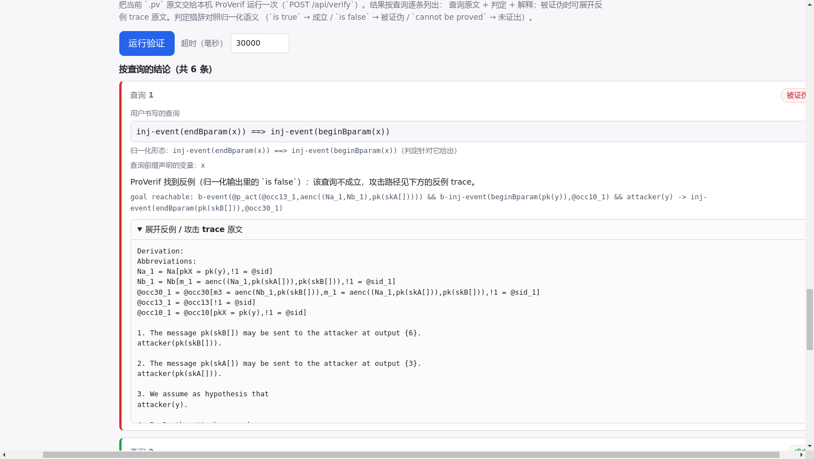

图 11　展开反例 trace 后，结果卡片超出视口宽度

---

## 5 需要猜测的记法与表述

### 5.1 消息与信道

- 未配对消息线没有方向标识，无法从 hello 画布判断 main 发送还是接收 RSA。
- 信道顶部的 ① 在图例中没有说明。
- 图例列出"→ 发出 / ← 接收"，画布上未出现这两个字形。
- hello 只有一个角色，图例却以"多方协议不自动连线"解释未配对。

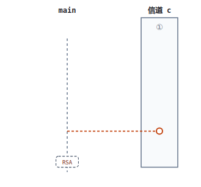

图 12　hello 画布，未配对消息线无方向，信道顶部 ① 无说明

### 5.2 值层与方法盒

- 四个事件均同时标为前提与结论，菱形与三角旗不再区分查询方向，图例也未说明这两种形状。
- 虚线边框值方块表示 `=pkA` 等值复制，图例未说明。
- `insert` 显示为空的黄色方框，文字位于框外。
- 同一条 `get` 语句绘制两次，分别为方法盒与 ∈ 检查盒。
- aenc 方法盒的宽端仅覆盖 5 个输入方块中的 3 个，嵌套的 sign 构造不可见。
- `then` 分支内的事件绘制在主生命线上，臂道竖轨位于其侧，归属关系不明确。

### 5.3 提示与标注

- 红色三角"!1"位于画布右侧空白处，悬停提示为"跨列禁置带""全局 y 唯一性""非静默重排"等实现术语。
- 角色签名、`event acce…`、诊断卡片"缺少…"、`if xB = A then …` 等文字被截断。
- 折叠后的分支条截去了隐藏步数"+14"。

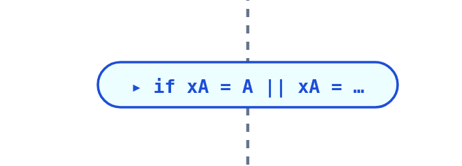

图 13　NS 修正版折叠后的分支条，隐藏步数未显示

### 5.4 矩阵与控件

- 矩阵初始单元格只显示"·"，对角单元格带"↺"，均无图注。
- 标题"4 个事件 × 16 条有序对"中的"×"易被理解为乘号。
- 紧凑度滑块没有刻度与数值。

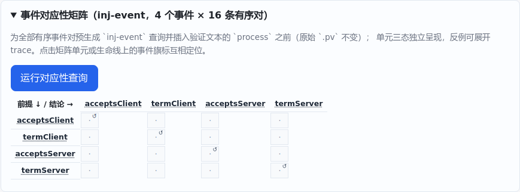

图 14　握手修正版对应性矩阵初始状态

### 5.5 人工配对入口

页面可见文字中"人工配对"出现 0 次，该功能仅在读屏标签中提及。用户需先点中一个发送端，才会看到操作提示。

### 5.6 不支持语法的降级呈现

- `phase 1` 的降级卡片绘制在 A 生命线顶端，而源码中该语句位于两次 `out` 之间。
- 该样本恰有两个角色，收发步骤同信道且类型兼容，但没有任何自动配对，界面也未说明原因。

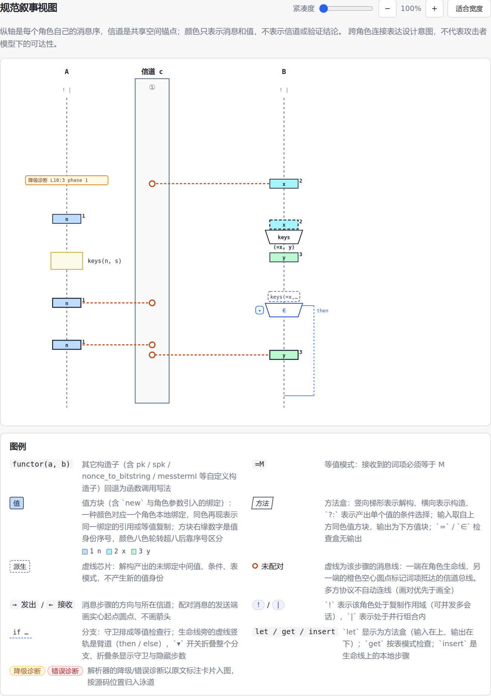

图 15　unsupported.pv 画布，phase 降级卡片位置与源码顺序不符

---

## 6 交互问题

- 点击画布上的值方块、端点或事件旗标，页面均滚回顶部源码面板。人工配对时，点击第一个端点后需再向下滚动约 1000 px 才能找到第二个端点；点击旗标后页面转到源码面板而非矩阵。
- 双向联动的滚动行为不一致。点击矩阵单元格时页面不滚动；点击源码行时画布出现高亮，但页面不滚动到画布。两个方向均无法直接看到联动结果。
- 参数方块映射到错误的源码行：pkB 声明于第 41 行，点击后高亮第 42 行，且正向高亮的底色较浅。
- 双击或重复单击事件旗标均未打开自反对查询；点击一个矩阵单元格会同时高亮 4 个行列表头。
- "适合宽度"无效：画布宽 1100 px、容器宽 866 px，点击后缩放仍为 100%。缩放至 60% 与 180% 的极限时，减号与加号按钮均未禁用；"100%"为只读读数，不能点击复位。
- 人工配对声明成功后没有确认提示。m3 为 bitstring、xB 为 host，二者类型不符的声明被直接接受且无警告，与 U3.10 不符。单条声明无法撤销。
- 验证运行期间"运行验证"按钮外观不变，运行状态仅以一行灰色小字表示。

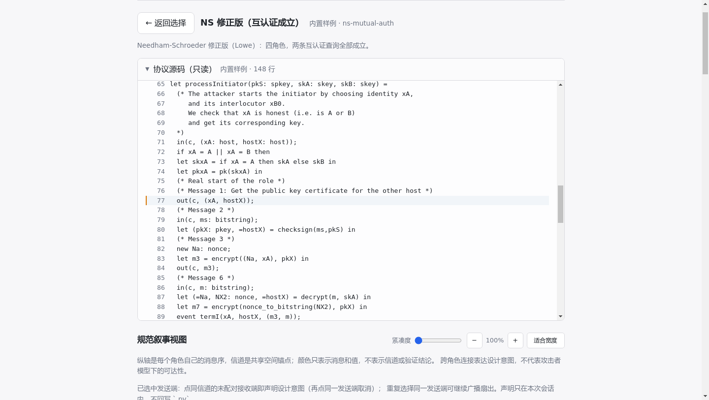

图 16　NS 修正版人工配对，点击第一个端点后页面跳至源码第 77 行

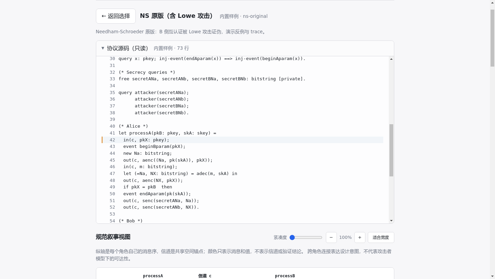

图 17　NS 原版点击参数 pkB 后，源码高亮第 42 行

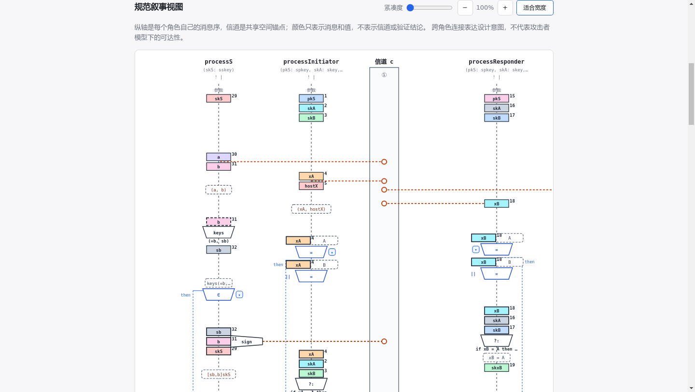

图 18　NS 修正版点击"适合宽度"后，缩放仍为 100%，processK 位于可视区域之外

---

## 7 布局

- 首页说明源码"显示在右侧"，实际位于画布上方。在 1440 px 宽的首屏中仅能看到画布顶部，U1.4 要求的图与文本并列查看未实现。
- 内容列宽固定为 866 px。在 1920 px 宽的屏幕上一半以上区域空白，四角色画布仍需横向滚动；processK 在 100% 缩放下不可见，横向滚动条位于约 2700 px 高的画布底部。

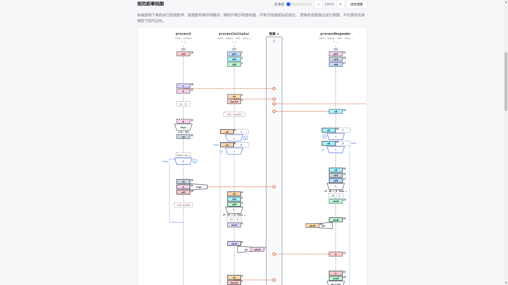

图 19　1920×1080 视口下的 NS 修正版

---

## 8 文案与术语

- 界面使用了词表禁用词"泳道"，见于图例、验证面板中的"泳道图只呈现能解析的部分"，以及画布读屏标签"2 条泳道，3 条跨泳道连线"。
- 反引号原样显示，例如 `` `.pv` ``、`` `is false` ``、`` `new` ``。
- 内部信息外露：`POST /api/verify`；画布整体的悬停提示"v2 结构化叙事布局"；"画布编辑属二期""冒烟""全绿""扇出源"等开发用语；stdout 中的服务端临时路径 `/tmp/pv-lens-verify-*/model.pv`。
- 同一语法错误给出两个列号：工具诊断为 L7:6，ProVerif 报告为 character 12；源码面板第 7 行没有错误标记。
- 判定为成立的查询下方直接显示 `goal reachable: …` 原文，未加解释。

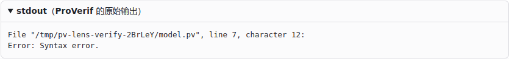

图 20　语法错误样本的 ProVerif 原始输出

---

## 9 灰度可辨性

U8.4 要求消息柱循环使用实线、短虚线、点线三种线型。实测三根消息柱均为实心填充，三条配对消息段的虚线样式相同。转为灰度后，M2 与 M3 几乎同色，配对与未配对的消息段只能依靠空心圆点区分，值方块的颜色身份完全丢失，仅余右侧序号。

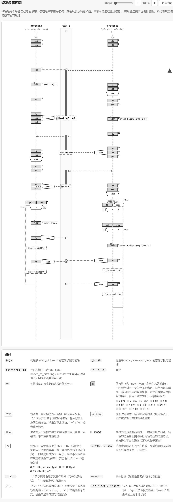

图 21　NS 原版画布的灰度渲染

---

## 10 通过的测试点

| 测试点 | 对应需求 | 证据 |
|---|---|---|
| 首页列出四个样例，可导入 `.pv` 文件并切换样例 | U1.1–U1.3 | 图 22 |
| 构造子符号化渲染，等值检查盒、选择盒，`&&` 与 `\|\|` 分行 | U2.5、U4.7、U4.9 | 图 23 |
| 人工配对基本流程，先选接收端时给出提示 | U3.10 | 图 24 |
| 对应性矩阵运行，✓ 与 ✗ 同时以形状和颜色编码 | U5.3 | 图 5 |
| 判定三态、归一化形态、反例 trace 与 stdout 可折叠 | U6.1、U6.4、U6.5 | 图 4 |
| 超时与取消的提示相互区分 | U6.6 | 图 25、图 26 |
| 模型自身错误给出中文指引，语法诊断给出行列位置 | U6.7 中的模型错误类、U7.2 | 图 27 |
| 缩放范围 60%–180%，步长 10%；分支可显式折叠 | U8.3、U4.10 | 图 28 |

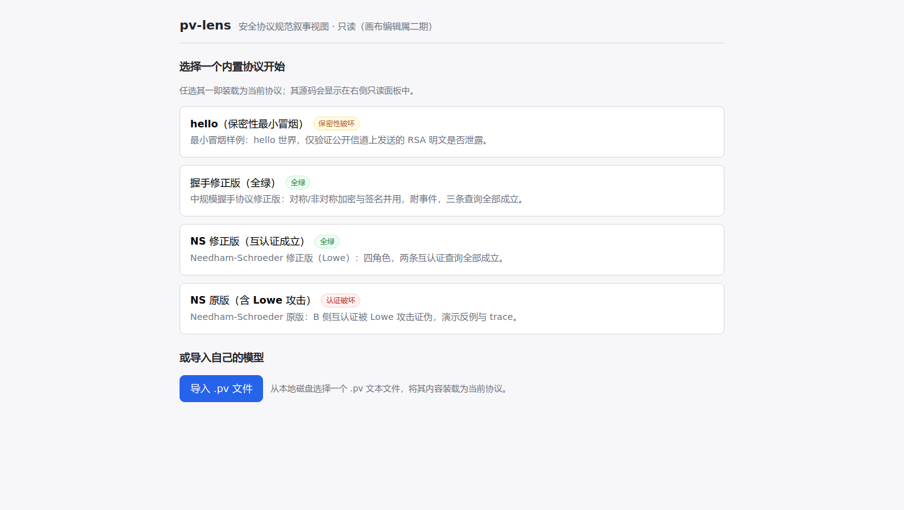

图 22　首页

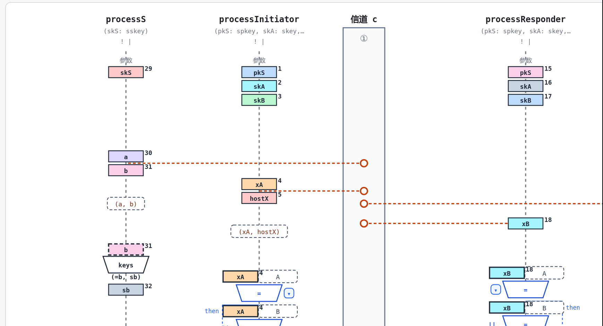

图 23　NS 修正版局部，含等值检查盒与 `||` 连接词

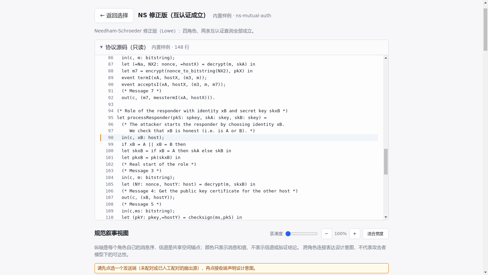

图 24　先点接收端时的提示

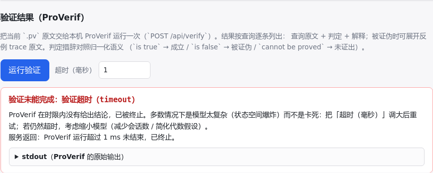

图 25　超时提示

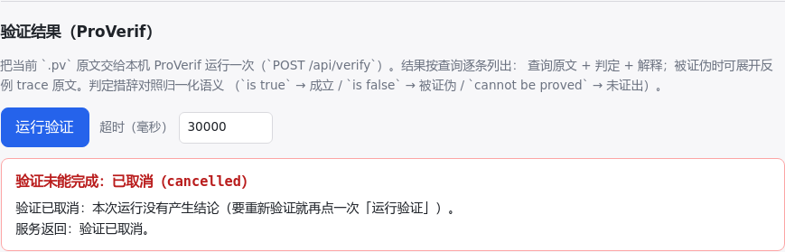

图 26　取消提示

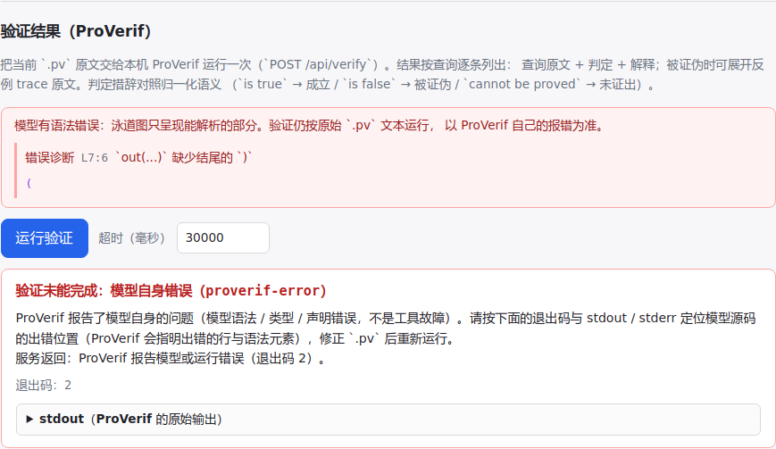

图 27　模型自身错误提示

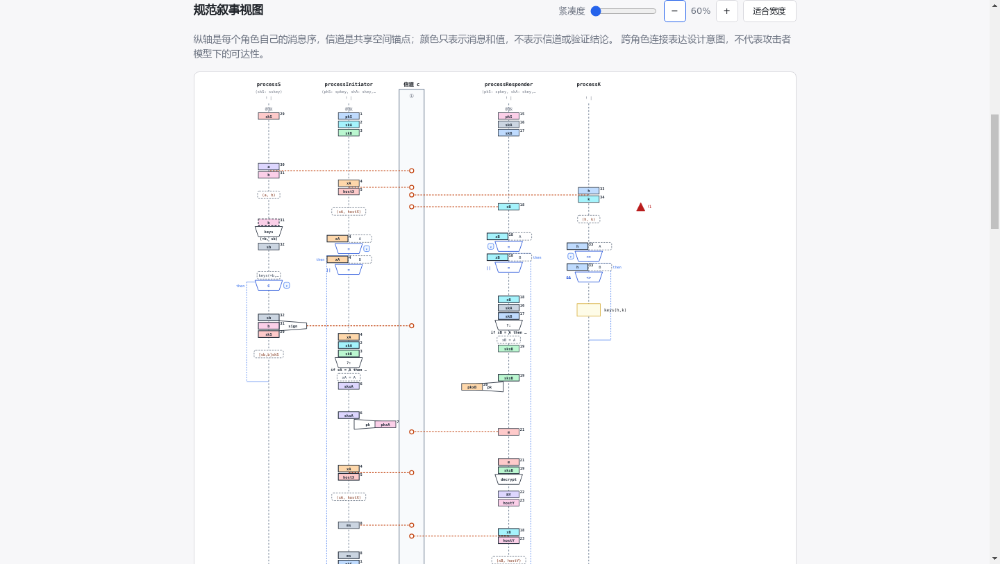

图 28　60% 缩放下的 NS 修正版

---

## 11 未覆盖的测试点

- 算子簇折叠：四个样例中均未出现，U8.2 无法验证。
- 跨信道拒绝：样例均为单信道，无法验证。
- 缺少 ProVerif 可执行文件与服务不可达两类失败：需停止正在运行的服务，未执行。
- 点击自动配对端点时的拒绝提示与键盘操作：未执行。

---

## 12 控制台记录

- React 重复 key 报错 187 条，涉及 10 个不同的 key，均位于分支守卫的操作数与方法盒，NS 修正版每次重渲染均复现。需求 T6 已登记该问题，记录为 8 处，实测为 10 个不同的 key。
- 504 与 500 各 1 条，分别来自超时测试与模型错误测试，属预期状态。
